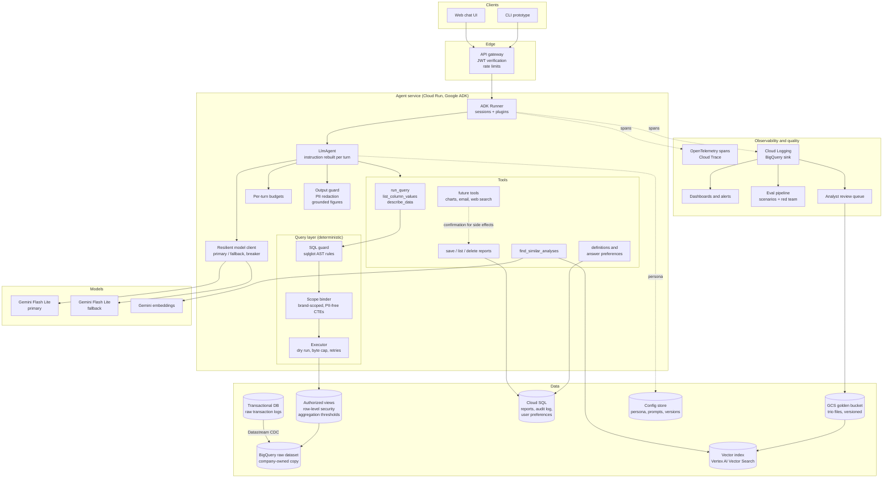
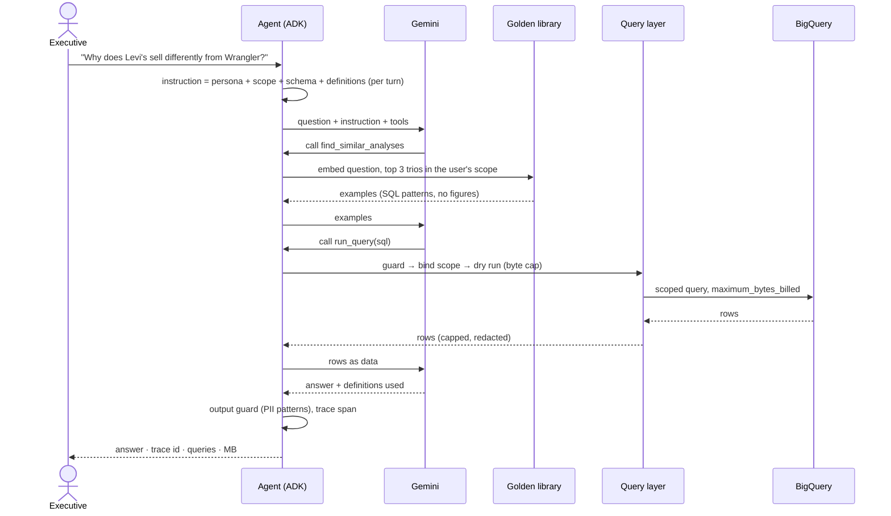
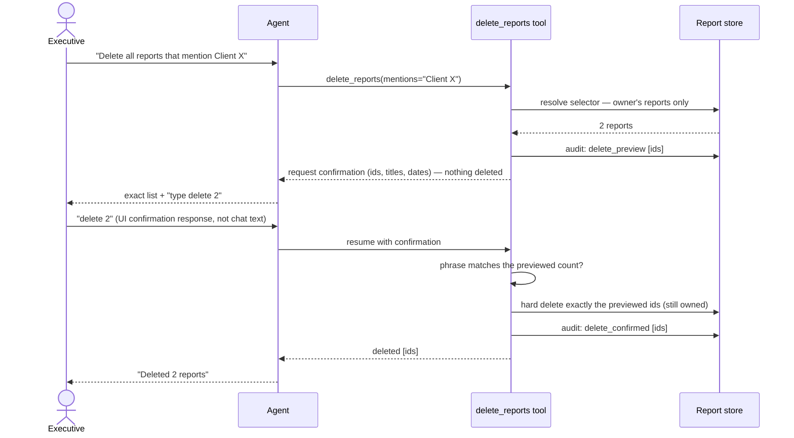
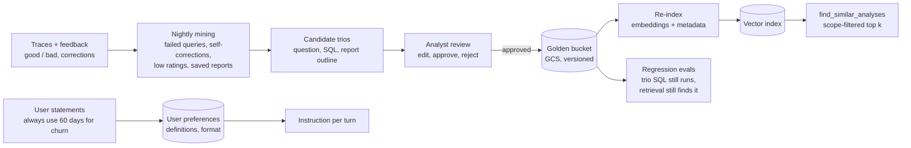

# High-level design — Retail Data Analysis Chat Agent

Scope and behaviour are specified in [SPEC.md](../SPEC.md); the reasoning behind each
choice is in [technical-explanation.md](technical-explanation.md) and the
[ADRs](adr/). This document is the target architecture; the last section maps each
component to what the prototype in this repository implements.

## 1. Architecture

The model never touches data directly. Every number reaches it through `run_query`, and
every query passes the same deterministic layer: the guard rejects anything that is not a
single read-only query over the four logical tables, the scope binder rewrites the table
names into brand-scoped, PII-free views of the data, and the executor dry-runs the query
under a byte cap before running it. Identity and scope come from the verified JWT via the
session, never from model arguments.

### Services and how they talk

| Building block | Service | Talks to | How |
|---|---|---|---|
| Web UI / CLI | Cloud Run (web), local CLI | Agent service | HTTPS + SSE streaming; JWT in `Authorization` |
| API gateway | API Gateway or Cloud Run ingress + IAP | Agent service | Verifies the JWT (issuer, audience, expiry, signature), rate-limits per user |
| Agent service | Cloud Run, Python, Google ADK | Gemini, BigQuery, Cloud SQL, Vector Search, config store | HTTPS/gRPC client libraries with a service account; no user credentials reach it |
| Models | Gemini via Vertex AI (paid) or Gemini API | — | Primary and fallback; embeddings for retrieval |
| Analytics data | BigQuery (`thelook_ecommerce` through authorized views) | — | Jobs run as the service account, dry run + byte cap per query |
| Application data | Cloud SQL for PostgreSQL | — | Sessions, reports, audit, preferences, definitions |
| Golden bucket | Cloud Storage + Vertex AI Vector Search | — | Trio files versioned in GCS, embeddings and metadata in the index |
| Config | Firestore (persona versions) | — | Read on every turn, cached briefly |
| Observability | Cloud Trace, Cloud Logging → BigQuery, Cloud Monitoring | — | OpenTelemetry spans from ADK; JSON spans as logs |

### Production data path

The prototype reads the public `thelook_ecommerce` dataset directly. Row-level security,
policy tags and aggregation-threshold rules can only be attached to tables and views a
company owns, so production lands the transaction logs in a company-owned dataset first:

1. **Ingest:** Datastream replicates the read-only transactional database into a BigQuery
   raw dataset with change data capture (minutes of delay); a nightly reconciliation job
   compares row counts and alerts on drift. Schema changes arrive as new columns and are
   ignored by the views until the logical schema is updated on purpose.
2. **Curate:** a curated dataset holds authorized views that match the four logical tables:
   PII columns are dropped or tagged with policy tags, `customer_key` is computed there with
   a salt from Secret Manager, row-level access policies filter by the brand claims of the
   caller, and the customer view carries an aggregation-threshold rule (minimum 5 distinct
   customers per group).
3. **Serve:** the agent's service account can only query the curated dataset. The scope
   binder still rewrites every query (defence in depth), and freshness (`MAX(created_at)`) is
   shown by `describe_data`.

## 2. Data: where it lives and how it is handled

| Data | Contains | Prototype | Production | PII | Retention and access |
|---|---|---|---|---|---|
| Transaction logs | orders, items, products, customers | BigQuery public dataset, read through scoped CTEs | Authorized views with row-level security and policy tags | Names, email, address, postal code, coordinates exist only here and are never selected | Read-only; the service account cannot write |
| Query results | rows for one tool call | In memory; returned to the model capped (200 rows, 20k chars) and redacted | Same | None (PII columns are not selectable; customers are `customer_key` pseudonyms) | Kept only inside the session (below) |
| Sessions | messages, tool calls and results, state | SQLite (`data/sessions.sqlite`, ADK `DatabaseSessionService`) | Cloud SQL | Pseudonymous only | Owner and support role; retention e.g. 90 days |
| Saved reports | title, Markdown body, entities, owner | SQLite (`data/reports.sqlite`) | Cloud SQL with owner predicates and row-level security | Redacted before saving | Author only; hard delete on confirmation; backups per retention policy |
| Audit log | who requested, previewed, confirmed, deleted which ids | SQLite table | Cloud Logging (write-once) | None (ids and actions, no content) | Compliance retention |
| Preferences and definitions | format, depth, visuals; business terms | SQLite (`data/preferences.sqlite`) | Cloud SQL | None | Per user; the user can reset |
| Persona | tone text and versions | `config/persona.md` default, `data/persona.md` + history | Firestore with versions | None | Persona editors write, everyone reads |
| Golden trios | question, SQL, report outline | `golden/trios/*.yaml`, `golden/index.json` | GCS (versioned) + Vector Search | No figures, no PII (tested) | Analysts curate; scope-filtered on read |
| Traces | spans: steps, models, SQL, rows, bytes, latency | `logs/traces.jsonl` | Cloud Trace + Logging → BigQuery | Metadata and the redacted user message, every string redacted | Engineering; retention e.g. 30 days |
| Secrets | Gemini key, salt, credentials | `.env` (git-ignored), ADC | Secret Manager, service accounts | — | Never in the repo, logs or prompts |

## 3. A question, end to end

Failures stay inside the turn. A rejected or failing query goes back to the model with an
actionable message (at most 3 failed attempts per turn). A rate-limited, slow or retired
model is replaced by the fallback. When a budget is reached, the agent answers with what it
has.

## 4. Destructive operations

The confirmation is ADK's tool-confirmation flow: the model cannot produce it, only the
client can, and the tool checks the typed phrase itself. More than 20 matches → no preview;
the user narrows the request. Other users' reports are never matched or mentioned.

## 5. Learning loop and golden knowledge

- **User level:** explicit preferences ("always use 60 days for churn", "tables, not
  bullets") are stored per user and injected into every turn; one-off overrides live in the
  conversation only.
- **System level:** traces show where the agent struggles (rejected SQL, empty results,
  self-corrections, bad ratings). Those cases become candidate trios that an analyst
  reviews. Approved trios are versioned in the golden bucket, re-indexed, and added to the
  regression evals, so the system improves without fine-tuning and every change can be
  reviewed.

## 6. Operations

- **Environments:** dev, staging and prod GCP projects; staging reads a sampled copy of the
  curated dataset. Infrastructure in Terraform (Cloud Run, Cloud SQL, datasets and views,
  Vector Search index, IAM, Secret Manager); CI/CD in Cloud Build: lint, offline tests and the
  red-team suite on every change, the scenario eval on prompt, persona, model or golden-set
  changes, then a canary revision on Cloud Run with automatic rollback on error-rate alerts.
- **Model versions:** model ids are pinned in configuration; a new model runs the full eval
  before it is promoted, and the fallback is a different model family version so a
  regression or retirement of one does not take both down.
- **SLOs (proposed):** 99.5% of turns per month end without a service error; p50 ≤ 6 s and
  p95 ≤ 15 s for answers that query data (the stage 7 session measured p50 9.8 s, p95 14.9 s
  on the free tier, with 2–4 model calls per turn); zero PII redactions and zero unverified
  figures in the release eval.
- **Cost model:** a measured turn uses about 8.4k input and 0.6k output tokens (6 calls,
  16,885 in / 1,249 out over two turns, stage 7). At the Gemini paid list price for
  gemini-3.5-flash-lite ($0.30 per 1M input, $2.50 per 1M output tokens, AI Studio pricing
  page, 2026-11-03) that is about **$0.004 per turn**; BigQuery adds 10–30 MB billed per
  turn, about $0.0002 at the on-demand list price of $6.25 per TiB (not re-checked against
  the live pricing page). 50 executives × 20 questions × 22 working days ≈ 22,000 turns ≈
  **$100 per month** for the model, with BigQuery inside the 1 TiB monthly free tier.
  Context caching of the static instruction prefix (the instruction now starts with the
  static rules and schema) and history compaction keep this flat as conversations grow.
- **Scaling:** the agent service is stateless; sessions, reports and preferences live in
  Cloud SQL. The circuit breaker is per instance; with many instances a shared breaker
  state in Memorystore (Redis) avoids each instance learning about an outage separately —
  an acceptable cost of a few extra failed calls is the alternative.
- **Streaming and the output guard:** the web UI streams progress events (which tool is
  running) immediately, but the answer text is released only after the output guard has
  checked the complete response for PII and unverified figures — redaction cannot be undone
  once text has been streamed.
- **Backups and recovery:** Cloud SQL point-in-time recovery (7 days); golden trios are
  versioned in GCS; the analytics data can be re-ingested from the source.

## 7. Security and privacy

- **Identity:** the gateway verifies the JWT; brand scopes and the persona-editor role come
  from the identity provider's groups, managed by the client's IT, not by the agent.
- **Input side:** Model Armor (or an equivalent prompt-injection and topic classifier) screens
  user messages and retrieved content before the model; the deterministic guards stay the
  last line of defence because classifiers miss things.
- **Untrusted content in context:** golden trios and saved reports are fed back to the model;
  trios enter only through analyst review, are scanned for PII and figures, and carry
  `status`; saved reports are the user's own and are treated as data, not instructions.
- **Erasure:** a deletion request for a customer removes their rows at the source; the
  pseudonym derived from the removed id disappears from the curated views on the next sync,
  and sessions and reports older than the retention period are purged; a key can be
  searched for in sessions and reports to remove it on request.
- **Secrets:** Secret Manager for the salt and API keys, rotated yearly; rotating the salt
  changes all `customer_key` values, so it is done together with purging stored sessions.

## 8. Prototype vs production

| Component | Prototype (this repo) | Production |
|---|---|---|
| Client and identity | CLI, `--user` over `config/users.yaml` | Web UI; JWT with `sub` and brand scopes, verified at the gateway |
| Agent runtime | Google ADK, local process | Same code on Cloud Run, horizontal scaling |
| Sessions | ADK `DatabaseSessionService` on SQLite | ADK `DatabaseSessionService` on Cloud SQL, or `VertexAiSessionService` |
| Brand scope | Scoped CTEs built per query, values as parameters | Same binder over authorized views with row-level security as a second wall |
| PII | Columns never selected; pseudonymous `customer_key`; demographics-in-aggregates rule in the guard; output redaction | Same, plus BigQuery aggregation threshold rules (minimum group size) and column-level policy tags |
| Query cost | Dry run, `maximum_bytes_billed` 1 GB, 1,000-row cap | Same, plus per-user daily byte quotas and BI Engine or materialized aggregates for hot queries |
| Reports and audit | SQLite, hard delete, audit table | Cloud SQL with owner predicates and row-level security, audit log to Cloud Logging, backups with retention |
| Golden bucket | 25 seed YAML trios, local embedding index with a similarity threshold, TF-IDF fallback | GCS bucket with versioned trios, Vertex AI Vector Search with metadata filters, review queue |
| Preferences and definitions | SQLite per user; `remember_preference`, `set_definition`, `/preferences`, `/definitions` | Cloud SQL; inferred preferences proposed to the user |
| Persona and prompts | Re-read every turn; persona editors use `/persona set` in the chat, versions kept | Versioned config store with edit UI, eval preview, staged rollout and rollback |
| Deep-dive debugging | `scripts/show_conversation.py <trace_id>` over the session store | Support console over Cloud SQL sessions joined with Cloud Trace |
| Extensions | Tool registry in `agent/tools.py` | Same; charts, email and web search as new tools behind confirmation and tracing |
| Model | Gemini 3.5 Flash Lite + 3.1 Flash Lite fallback, free tier | Paid tier or Vertex AI with provisioned throughput; same fallback logic |
| Observability | JSON-line spans, `/trace`, `/stats` | ADK OpenTelemetry → Cloud Trace; logs → BigQuery sink → dashboards and alerts |
| QA | Offline tests, live tests, scenario + red-team evals | Same suites in CI and nightly, results tracked over time |
