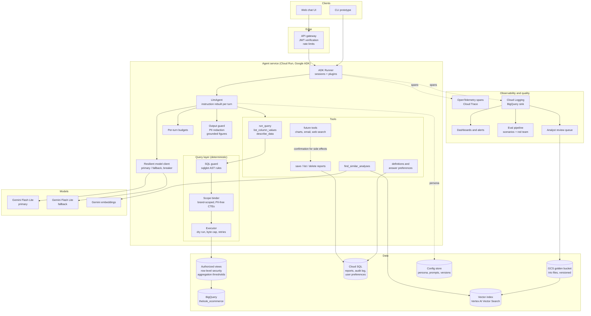
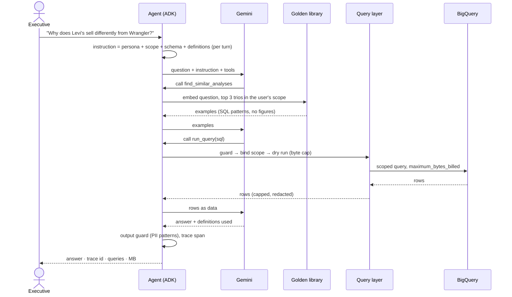
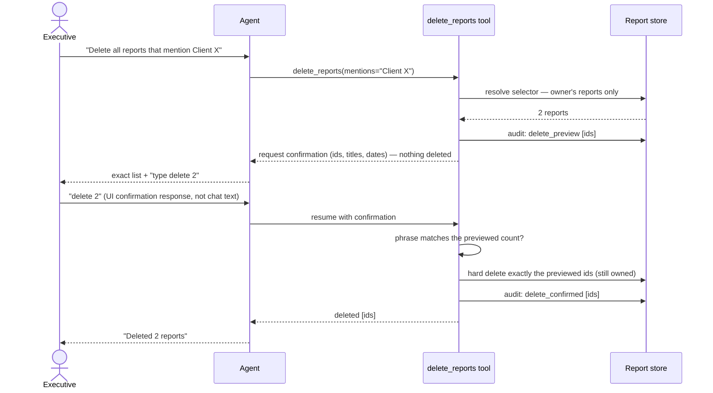
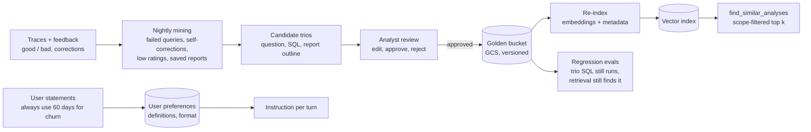

# High-level design — Retail Data Analysis Chat Agent

Scope and behaviour are specified in [SPEC.md](../SPEC.md); the reasoning behind each
choice is in [technical-explanation.md](technical-explanation.md) and the
[ADRs](adr/). This document is the target architecture; the last section maps each
component to what the prototype in this repository implements.

## 1. Architecture

The model never touches data directly. Every number reaches it through `run_query`, and
every query passes the same deterministic layer: the guard rejects anything that is not a
single read-only query over the four logical tables, the scope binder rewrites the table
names into brand-scoped, PII-free views of the data, and the executor dry-runs the query
under a byte cap before running it. Identity and scope come from the verified JWT via the
session, never from model arguments.

### Services and how they talk

| Building block | Service | Talks to | How |
|---|---|---|---|
| Web UI / CLI | Cloud Run (web), local CLI | Agent service | HTTPS + SSE streaming; JWT in `Authorization` |
| API gateway | API Gateway or Cloud Run ingress + IAP | Agent service | Verifies the JWT (issuer, audience, expiry, signature), rate-limits per user |
| Agent service | Cloud Run, Python, Google ADK | Gemini, BigQuery, Cloud SQL, Vector Search, config store | HTTPS/gRPC client libraries with a service account; no user credentials reach it |
| Models | Gemini via Vertex AI (paid) or Gemini API | — | Primary and fallback; embeddings for retrieval |
| Analytics data | BigQuery (`thelook_ecommerce` through authorized views) | — | Jobs run as the service account, dry run + byte cap per query |
| Application data | Cloud SQL for PostgreSQL | — | Sessions, reports, audit, preferences, definitions |
| Golden bucket | Cloud Storage + Vertex AI Vector Search | — | Trio files versioned in GCS, embeddings and metadata in the index |
| Config | Firestore (persona versions) | — | Read on every turn, cached briefly |
| Observability | Cloud Trace, Cloud Logging → BigQuery, Cloud Monitoring | — | OpenTelemetry spans from ADK; JSON spans as logs |

## 2. Data: where it lives and how it is handled

| Data | Contains | Prototype | Production | PII | Retention and access |
|---|---|---|---|---|---|
| Transaction logs | orders, items, products, customers | BigQuery public dataset, read through scoped CTEs | Authorized views with row-level security and policy tags | Names, email, address, postal code, coordinates exist only here and are never selected | Read-only; the service account cannot write |
| Query results | rows for one tool call | In memory; returned to the model capped (200 rows, 20k chars) and redacted | Same | None (PII columns are not selectable; customers are `customer_key` pseudonyms) | Kept only inside the session (below) |
| Sessions | messages, tool calls and results, state | SQLite (`data/sessions.sqlite`, ADK `DatabaseSessionService`) | Cloud SQL | Pseudonymous only | Owner and support role; retention e.g. 90 days |
| Saved reports | title, Markdown body, entities, owner | SQLite (`data/reports.sqlite`) | Cloud SQL with owner predicates and row-level security | Redacted before saving | Author only; hard delete on confirmation; backups per retention policy |
| Audit log | who requested, previewed, confirmed, deleted which ids | SQLite table | Cloud Logging (write-once) | None (ids and actions, no content) | Compliance retention |
| Preferences and definitions | format, depth, visuals; business terms | SQLite (`data/preferences.sqlite`) | Cloud SQL | None | Per user; the user can reset |
| Persona | tone text and versions | `config/persona.md` default, `data/persona.md` + history | Firestore with versions | None | Persona editors write, everyone reads |
| Golden trios | question, SQL, report outline | `golden/trios/*.yaml`, `golden/index.json` | GCS (versioned) + Vector Search | No figures, no PII (tested) | Analysts curate; scope-filtered on read |
| Traces | spans: steps, models, SQL, rows, bytes, latency | `logs/traces.jsonl` | Cloud Trace + Logging → BigQuery | Metadata only, every string redacted | Engineering; retention e.g. 30 days |
| Secrets | Gemini key, salt, credentials | `.env` (git-ignored), ADC | Secret Manager, service accounts | — | Never in the repo, logs or prompts |

## 3. A question, end to end

Failures stay inside the turn. A rejected or failing query goes back to the model with an
actionable message (at most 3 failed attempts per turn). A rate-limited, slow or retired
model is replaced by the fallback. When a budget is reached, the agent answers with what it
has.

## 4. Destructive operations

The confirmation is ADK's tool-confirmation flow: the model cannot produce it, only the
client can, and the tool checks the typed phrase itself. More than 20 matches → no preview;
the user narrows the request. Other users' reports are never matched or mentioned.

## 5. Learning loop and golden knowledge

- **User level:** explicit preferences ("always use 60 days for churn", "tables, not
  bullets") are stored per user and injected into every turn; one-off overrides live in the
  conversation only.
- **System level:** traces show where the agent struggles (rejected SQL, empty results,
  self-corrections, bad ratings). Those cases become candidate trios that an analyst
  reviews. Approved trios are versioned in the golden bucket, re-indexed, and added to the
  regression evals, so the system improves without fine-tuning and every change can be
  reviewed.

## 6. Prototype vs production

| Component | Prototype (this repo) | Production |
|---|---|---|
| Client and identity | CLI, `--user` over `config/users.yaml` | Web UI; JWT with `sub` and brand scopes, verified at the gateway |
| Agent runtime | Google ADK, local process | Same code on Cloud Run, horizontal scaling |
| Sessions | ADK `DatabaseSessionService` on SQLite | ADK `DatabaseSessionService` on Cloud SQL, or `VertexAiSessionService` |
| Brand scope | Scoped CTEs built per query, values as parameters | Same binder over authorized views with row-level security as a second wall |
| PII | Columns never selected; pseudonymous `customer_key`; demographics-in-aggregates rule in the guard; output redaction | Same, plus BigQuery aggregation threshold rules (minimum group size) and column-level policy tags |
| Query cost | Dry run, `maximum_bytes_billed` 1 GB, 1,000-row cap | Same, plus per-user daily byte quotas and BI Engine or materialized aggregates for hot queries |
| Reports and audit | SQLite, hard delete, audit table | Cloud SQL with owner predicates and row-level security, audit log to Cloud Logging, backups with retention |
| Golden bucket | 23 seed YAML trios, local embedding index, TF-IDF fallback | GCS bucket with versioned trios, Vertex AI Vector Search with metadata filters, review queue |
| Preferences and definitions | SQLite per user; `remember_preference`, `set_definition`, `/preferences`, `/definitions` | Cloud SQL; inferred preferences proposed to the user |
| Persona and prompts | Re-read every turn; persona editors use `/persona set` in the chat, versions kept | Versioned config store with edit UI, eval preview, staged rollout and rollback |
| Deep-dive debugging | `scripts/show_conversation.py <trace_id>` over the session store | Support console over Cloud SQL sessions joined with Cloud Trace |
| Extensions | Tool registry in `agent/tools.py` | Same; charts, email and web search as new tools behind confirmation and tracing |
| Model | Gemini 3.5 Flash Lite + 3.1 Flash Lite fallback, free tier | Paid tier or Vertex AI with provisioned throughput; same fallback logic |
| Observability | JSON-line spans, `/trace`, `/stats` | ADK OpenTelemetry → Cloud Trace; logs → BigQuery sink → dashboards and alerts |
| QA | Offline tests, live tests, scenario + red-team evals | Same suites in CI and nightly, results tracked over time |
